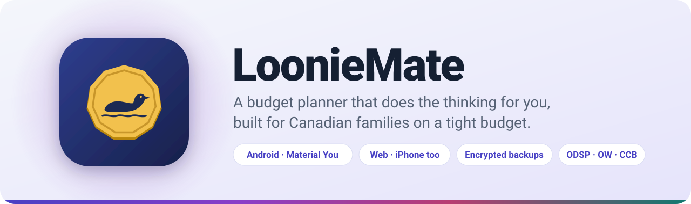
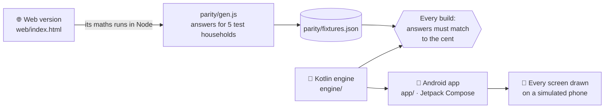

<a name="top"></a>

<picture>
  <source media="(prefers-color-scheme: dark)" srcset="docs/assets/banner-dark.svg">
  
</picture>

<p align="center">
  <a href="../../releases/latest"></a>
  <a href="../../actions/workflows/build.yml"></a>
  
  
  
  
</p>

<p align="center">
  <b><a href="../../releases/latest">Download for Android</a></b> &nbsp;·&nbsp;
  <b><a href="https://ryangjpriorx.github.io/LoonieMate/">Open the web version</a></b> &nbsp;·&nbsp;
  <a href="#-features">Features</a> &nbsp;·&nbsp;
  <a href="#-privacy">Privacy</a> &nbsp;·&nbsp;
  <a href="#-how-its-built">How it's built</a>
</p>

---

LoonieMate plans a household's money **one paycheque at a time**. Tell it what comes in (ODSP or Ontario Works, a bi-weekly paycheque, the Canada Child Benefit and other benefits) and what goes out (rent, phones, diapers, pet food). It then tells you, every day, **what to pay, which money to move between accounts, how much food money is left**, and what's safe to put into savings.

It was built for a family living on social assistance and benefits, where a late bill or a short month really hurts. It was designed with busy, distracted brains in mind: one screen to check, one tap to log a purchase, and nothing to work out in your head.

<table>
  <tr>
    <td align="center" width="25%">
      <picture>
        <source media="(prefers-color-scheme: dark)" srcset="https://raw.githubusercontent.com/ryangjpriorx/LoonieMate/screens/readme-dark-today.png">
        
      </picture>
      <br><sub><b>Today</b>: what to do right now</sub>
    </td>
    <td align="center" width="25%">
      <picture>
        <source media="(prefers-color-scheme: dark)" srcset="https://raw.githubusercontent.com/ryangjpriorx/LoonieMate/screens/readme-dark-month.png">
        
      </picture>
      <br><sub><b>Month</b>: the plan and how it's going</sub>
    </td>
    <td align="center" width="25%">
      <picture>
        <source media="(prefers-color-scheme: dark)" srcset="https://raw.githubusercontent.com/ryangjpriorx/LoonieMate/screens/readme-dark-bills.png">
        
      </picture>
      <br><sub><b>Bills</b>: adults, kids, pets and debts</sub>
    </td>
    <td align="center" width="25%">
      <picture>
        <source media="(prefers-color-scheme: dark)" srcset="https://raw.githubusercontent.com/ryangjpriorx/LoonieMate/screens/readme-dark-settings.png">
        
      </picture>
      <br><sub><b>Settings</b>: your colours, your backups</sub>
    </td>
  </tr>
</table>

<sub>Screenshots use a made-up household and are redrawn by every build, so they always show the current version. They follow your GitHub light or dark setting.</sub>

## ✨ Features

### 📅 Today, at a glance
- **To do today**: bills that are due and money moves to make, each with one tap to tick off (and Undo).
- **Food money** for this half of the month, with what you can spend per day and a marker showing where you should be by now.
- **One-tap spending buttons** for the things you buy often. LoonieMate suggests them from what you log.
- **Debt payoff rings** with milestones: a quarter done, halfway there, almost done.
- A status badge that says, in plain words, whether the month is **on track**, needs a **heads up**, or **needs attention**, and why.

### 💸 Every paycheque has a job
- Income that **covers rent first** (like ODSP), then bills **split across the main paycheques**.
- **Money moves**: *"Move $332.53 to the Everyday card on payday, for the bills due before the next one."* Accounts are set up by purpose (main, rent, everyday, online), so the moves work themselves out.
- **Extra paydays** (the 3rd bi-weekly cheque some months) go to savings after any shortfall is covered.
- A **food allowance** that grows with what's left after bills and never drops below your minimum, split into the 1st–15th and the 16th–end.

### 🏛️ Knows how assistance and benefits actually work
- **Ontario Disability Support Program (ODSP)** and **Ontario Works** with their real payment dates and **earnings deductions**: the $1,000 disability exemption and 75%, the $200 exemption and 50%, the $100 work-related benefit, and income that counts in full. Each one can be turned on or off.
- **Québec** Social Assistance, Social Solidarity and Basic Income, and **Nova Scotia** Income Assistance (including the supported-employment scale).
- **Reminders to report income** by each program's deadline, listing what came in last month.
- **Benefit dates on the right day**: Canada Child Benefit, Canada Groceries and Essentials Benefit, Ontario Trillium Benefit, Canada Workers Benefit advance, Canada Disability Benefit, and provincial child and tax credits. They're moved for weekends and **bank holidays**, following the CRA's published schedules and Payments Canada's holidays.
- A **tax-season reminder**, with free ways to file (CRA SimpleFile, free tax clinics, StudioTax).

### 🛟 When a month comes up short
- **Give up a non-essential** for one month (all of it or part of it) with a slider that shows when the shortfall is covered.
- **Pay a deferrable bill later**: push part of it to a payday next month.
- If it's still short: *"Cover it from Emergency Savings first. Use the Child Reserve only as a last resort."*

### 👶 Savings that protect the kids
- The **Child Benefit is kept in a protected Child Reserve**, separate from spending money. You can choose to send a share to Emergency Savings in good months.
- Savings funds for the costs that catch families off guard: a vet fund, Christmas, winter coats, car repairs.
- Help with **free government money**: the Canada Learning Bond checklist, and RDSP, RESP and TFSA estimates, plus how close you are to the ODSP asset limit. *(In the web version for now; coming to the app.)*

### 🧾 Bills and debts
- Bills for **Adults, Kids and Pets**, monthly, every 2 weeks, weekly, every 3 months or yearly. Bills that come every 3 months or once a year are **set aside a little each month**.
- **Debts** (loans, consumer proposals, payment plans) from the original amount or a statement balance, with interest, **missed payments**, and **extra payments** like a lump sum from a tax refund. LoonieMate shows what's left and the month it'll be paid off.

### 🎨 Feels at home on your phone
- **Material You**: on Android 12 and later, LoonieMate takes its colours from your wallpaper. You can also pick one of six colour themes, in light or dark.
- **Smooth on flagships, quick on budget phones.** Visual effects (animated rings, count-ups, motion) turn on by themselves on phones with the power for them, and stay off on low-end phones. You can switch them either way.

## 📲 Get LoonieMate

<table>
  <tr>
    <th width="50%">🤖 Android</th>
    <th width="50%">🌐 Web (iPhone, computers, any phone)</th>
  </tr>
  <tr>
    <td valign="top">

1. On your phone, open the **[latest release](../../releases/latest)** and download `LoonieMate-x.y.z.apk`.
2. Open the file. Android asks you to allow installs from your browser or Files app; allow it.
3. That's it. LoonieMate **updates itself from this page**: when there's a new version, tap **Install**.

Needs Android 8.0 or later.

</td>
    <td valign="top">

1. Open **[ryangjpriorx.github.io/LoonieMate](https://ryangjpriorx.github.io/LoonieMate/)**.
2. On iPhone, tap **Share → Add to Home Screen** to open it like an app.

It does everything the Android app does, without the extra visuals. Your budget is saved in that browser on that device.

</td>
  </tr>
</table>

**Moving between them:** both use the **same encrypted backup file**. Export a backup on one (Settings → Export) and import it on the other. You can **combine** two copies: for anything changed in both places, the newest change wins.

<details>
<summary><b>What the Android app has today, and what's still web-only</b></summary>

| | Android app | Web version |
|---|:---:|:---:|
| Today: to-dos, food money, quick logging, debts | ✅ | ✅ |
| Month: status, shortfall help, money plan | ✅ | ✅ |
| Bills, including debts | ✅ | ✅ |
| Spending and one-time expenses | ✅ | ✅ |
| Encrypted backups (same file) | ✅ | ✅ |
| Material You, effects tuned to the phone | ✅ | — |
| Updates itself | ✅ | always current |
| Food, Savings, Income and benefits, Accounts | 🔜 | ✅ |
| Balance checks | 🔜 | ✅ |
| Google Drive sync | 🔜 | — |
| Reminders and a home-screen widget | 🔜 | — |

</details>

## 🔒 Privacy

- **No account, no server, no ads, no tracking.** Your budget lives only on your phone (or in your browser).
- **Backups are locked with a password you choose**: AES-256-GCM, with the key made from your password by PBKDF2-SHA256 at 600,000 rounds. Nobody can open a backup without the password, including us. **If the password is lost, the backup can't be opened.**
- Android's own cloud backup is turned off, so your budget is never copied anywhere unencrypted.
- The only thing the app does on the internet is check this page for updates. A download is installed only if its fingerprint (SHA-256) matches and it's **signed with LoonieMate's key**.

## 🛠️ How it's built



The budget maths was written once for the web version and **ported line for line to Kotlin**. On every build, the web version's own code works out about 29,000 values for five made-up households (Ontario, Québec, Nova Scotia, an older saved format, and an empty budget). The Android engine has to match every one. It also has to open the web version's backups and match how the web version combines two copies. If anything drifts, the build fails.

| Folder | What's in it |
|---|---|
| [`engine/`](engine) | The budget maths in plain Kotlin with no Android code: pay dates and bank holidays, benefit schedules, assistance deductions, bills, food, savings, money moves, debt payoff, encrypted backups. |
| [`parity/`](parity) | The test households and the script that gets the web version's answers. |
| [`app/`](app) | The Android app: Kotlin, Jetpack Compose, Material 3, in-app updater. |
| [`web/`](web) | The web version: a single page with no build step. |
| [`signing/`](signing) | The release signing key, encrypted. |

<details>
<summary><b>Building it yourself</b></summary>

You need JDK 17 and Node 20 or later. Android Studio is optional.

```bash
node parity/gen.js              # the web version's answers
./gradlew :engine:test          # the Kotlin engine must match them
./gradlew :app:assembleDebug    # a test copy of the app (installs alongside the real one)
./gradlew :app:testDebugUnitTest  # draws every screen into app/build/screens
```

</details>

<details>
<summary><b>Publishing a release</b></summary>

1. Put the new version in [`version.txt`](version.txt) (for example `0.2.0`).
2. Add release notes in `docs/releases/v0.2.0.md`.
3. Push to `main`. The **Release** workflow builds, signs and publishes it, and phones running LoonieMate offer the update.

Signing needs the `SIGNING_PASSPHRASE` Actions secret. Every release must be signed with the same key, or phones refuse the update.

</details>

## 🗺️ Roadmap

- [x] Native Android app with the web version's maths, matched to the cent
- [x] Encrypted backups shared between the app and the web version
- [x] Updates itself from GitHub
- [ ] Food, Savings, Income and benefits, Accounts and balance checks in the app
- [ ] Google Drive sync between two phones (the same encrypted backup file)
- [ ] Bill and money-move reminders, and a home-screen widget
- [ ] More provinces' assistance programs

## 💬 Feedback

Found a wrong number, or have an idea? **[Open an issue](../../issues/new/choose)**. Programs and benefits from other provinces are especially welcome. Please **don't post your budget or a backup file**: issues are public.

<p align="right"><a href="#top">Back to top ↑</a></p>
